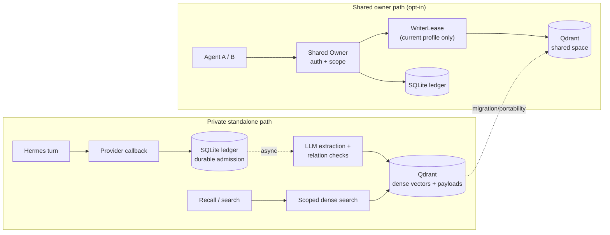
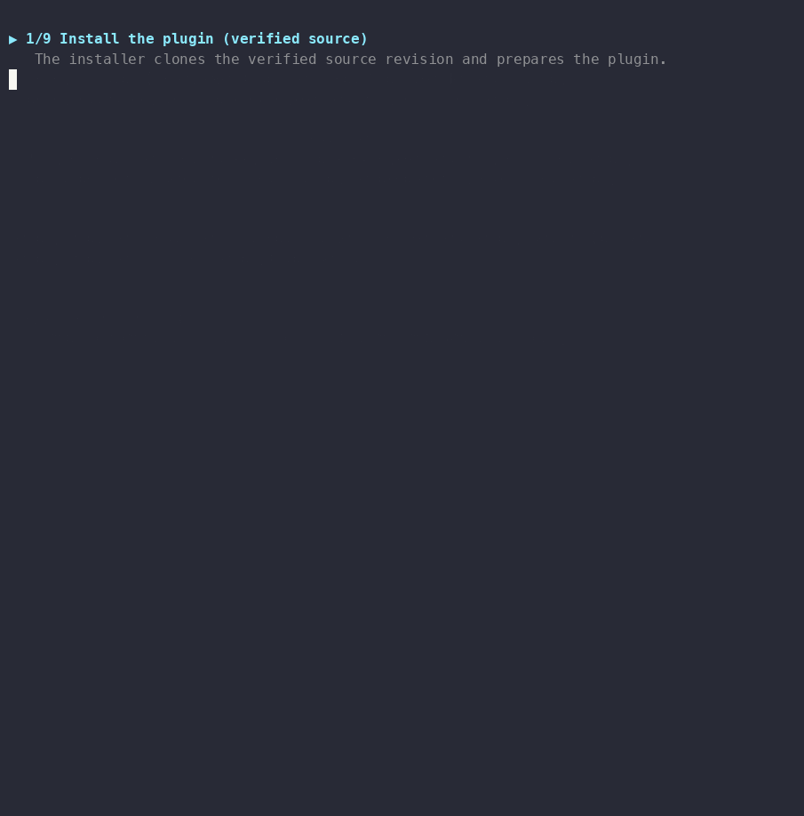

# Qdrant Memory Runtime

**One Memory. Multiple Agents. No Lock-in.**

Durable, portable, permission-aware memory for AI agents. Hermes, MCP, CLI and
Agent Skills use one Qdrant backend. The standalone CLI and MCP do not require Hermes.

An optional Shared Owner supports cross-agent and cross-device sharing and extraction.
Keep one writer per destination. See [shared setup](docs/shared-memory/README.md),
[remote Owner](docs/shared-memory/remote-owner.md),
[deployment security](docs/shared-memory/deployment-security.md) and the
[threat model](docs/shared-memory/threat-model-v1.md).

[](https://github.com/cnkang/hermes-plugin-qdrant-memory/actions/workflows/ci.yml)
[](https://github.com/cnkang/hermes-plugin-qdrant-memory/actions/workflows/platform-compat.yml)
[](https://github.com/cnkang/hermes-plugin-qdrant-memory/actions/workflows/standalone.yml)
[](https://github.com/cnkang/hermes-plugin-qdrant-memory/actions/workflows/codeql.yml)
[](https://www.python.org/downloads/)
[](LICENSE)

> **Runtime 0.6.2** adds receipt-scoped retries for durably failed lifecycle events. The Owner validates the saved event plan and requeues only its failed operations; quarantined events stay operator-controlled.
> Secure file handling supports macOS, Linux and supported Windows local volumes.
> Handoff stays `HANDOFF_PENDING` with `native_verified=false` until the native client confirms adoption.
> Scoped deletion also supersedes quarantined events before later retries.
> It retains official FastEmbed 0.9.1. This guide selects Runtime 0.6.2.
> Check its availability on
> [PyPI](https://pypi.org/project/hermes-plugin-qdrant-memory/0.6.2/) before installation.
> If a package mirror has not indexed the release yet, use the
> [published 0.6.1 guide](https://github.com/cnkang/hermes-plugin-qdrant-memory/blob/v0.6.1/README.md)
> or install the versioned source tag below.
> The generic MCP distribution and managed launcher select their own exact Runtime
> dependency and are released independently.
> The Hermes Plugin Catalog has its own reviewed immutable pin. A PyPI release
> does not upgrade it. One writer per destination remains required.
> See [release notes](docs/releases/0.6.2.md) and [validation](docs/validation.md).

Keep readable exports and original
harness data when switching tools. Prefer supported harness import/export APIs.
Use portable handoff when native bulk import is unavailable. Uninstalling an
integration preserves memories, backups and sources. See [Codex portability](docs/codex-memory.md).

CPU profiles from before Runtime 0.5.5 may use FastEmbed 0.9.0. The current
0.9.1 pipeline has a different fingerprint. Preserve the old environment, store
and cache. With authorization, export and re-embed into a new profile and
collection. Verify before switching clients. Never relabel stored fingerprints
or model markers to force an upgrade.

[English](README.md) | [简体中文](README.zh-CN.md)

Native long-term memory plugin for Hermes Agent, implemented as a `MemoryProvider`.
Hermes performs extraction
through its trusted `ctx.llm` facade. Qdrant stores named dense vectors and schema-v1
payloads. No Mem0 SDK, separate LLM SDK, telemetry, or core modifications.

Available in the official [Hermes Plugin Catalog](https://hermes-agent.nousresearch.com/docs/plugins/qdrant-memory)
as a community-maintained plugin.

## How it works

For non-Hermes users, install in a private Python 3.11+
environment: `pip install 'hermes-plugin-qdrant-memory[mcp]==0.6.2'` (omit `[mcp]`
for CLI only). `qdrant-memory` is the CLI and `mcp` is its server subcommand.
Standalone does not require Hermes. See [setup and quick start](docs/standalone.md).
MCP-focused agents may instead use the [metadata-only distribution](https://github.com/cnkang/qdrant-memory-mcp).
Public releases: [Runtime on PyPI](https://pypi.org/project/hermes-plugin-qdrant-memory/)
and [MCP distribution on PyPI](https://pypi.org/project/qdrant-memory-mcp/).
For native Hermes use its official plugin installation mechanism below. Before
an authorized upgrade, verify the same profile, collection and embedding pipeline.



`WriterLease` coordinates only the current profile's writes. It does not prevent
other profiles or devices from writing to the same destination. "One writer per
destination" is an operational constraint, not an automatic cross-device lock.

## Why Qdrant Memory

- Durable, private memory for Hermes Agent: conversations become searchable
  memories in your own Qdrant store, with recall, update and scoped deletion.
- A native Hermes `MemoryProvider` and a `migrate mem0` command for existing exports.
- Embedded Qdrant needs no separate service. The same code targets
  self-hosted Server and Qdrant Cloud.
- A fully local setup works: embedded Qdrant and local Ollama keep the data
  on your machine.
- Data locality follows the destination. Extraction uses the LLM configured
  in Hermes, and embedding uses the configured embedding service. Either can
  be remote. See [Data flow and privacy](#data-flow-and-privacy).
- Independent writers to one destination, hybrid search and a web UI are unsupported.

## MCP, CLI and other agents

The Runtime provides a Hermes native provider, a standalone JSON CLI and optional local stdio MCP.
Call the CLI as `qdrant-memory --home PATH`. These interfaces provide scoped memory operations,
maintenance and migration. Automatic extraction and prefetch use the Hermes Native Owner or the opt-in Pi lifecycle adapter.
See [standalone setup](docs/standalone.md) for configuration and boundaries, and the agent-neutral
[qdrant-memory skill](https://github.com/cnkang/skills/tree/main/qdrant-memory)
for multi-agent installation and usage guidance.

The optional MCP server exposes four scoped tools: `qdrant_memory_search`,
`qdrant_memory_add`, `qdrant_memory_update` and `qdrant_memory_delete`. Compatible
clients launch it as a local stdio process and discover/call those tools.
Maintenance and migration use the operator CLI. See the
[MCP capabilities and connection guide](docs/mcp.md) for setup, shared-memory
boundaries and the verified agent matrix.

## See it in action



The recording illustrates Hermes extraction and recall on an embedded profile.
The current `scripts/demo.sh` uses this guide's reviewed source pin to replay
the workflow. See [validation](docs/validation.md) for the tested versions and limits.

## Choose your setup

| Use case | Recommended entry | Notes |
|---|---|---|
| Hermes native automatic memory | Native MemoryProvider | Automatic extraction and recall inside Hermes |
| Single agent, standalone MCP | Standalone MCP (`qdrant-memory-mcp`) | Explicit tools only, no auto-extraction |
| Multiple agents sharing memory | Authenticated Shared Owner | Opt-in. One writer per destination |
| Remote / multi-device access | HTTPS MCP + Owner | TLS, auth and network protection required |
| WorkBuddy | Host integration guides | Reuse the same Runtime |
| DSH published MCP | MCP Bundle or Python overlay | Explicit tools; no automatic capture or recall |
| DSH native adapter | Source preview with candidate-event Runtime support | Opt-in lifecycle path; no real-model or GUI acceptance |
| Codex portability | Runtime `codex` CLI and candidate plugin | Explicit import and portable handoff; native adoption needs client confirmation |
| Migrate Mem0 data | Migration CLI | Source IDs, resumable manifest, verification |

See [standalone setup](docs/standalone.md), [shared memory](docs/shared-memory/README.md), and [cross-harness architecture](https://github.com/cnkang/qdrant-memory-mcp/blob/main/docs/cross-harness-architecture.md).

## Install

These steps install the Hermes adapter. CLI/MCP users should follow
[standalone setup](docs/standalone.md).

Requirements: Python 3.11+, a compatible Hermes installation, and a reachable
embedding service. The minimum supported Hermes release is v0.21.5 (v2026.9.24).
The [CI services](docs/ci.md) page documents the tested host versions.
The default model needs Ollama and enough local resources
to serve `qwen3-embedding:4b`.

Choose the **active profile's** home explicitly. Do not reuse another profile's data.

**Recommended: install the version-locked Runtime 0.6.2 source through the Hermes CLI.**

This immutable source revision includes opt-in shared memory. It does not depend
on a PyPI release or a catalog update.

```bash
export HERMES_HOME="/absolute/path/to/your/hermes-profile"
ollama pull qwen3-embedding:4b
# Start Ollama if it is not running. Keep its service available.
hermes plugins install https://github.com/cnkang/hermes-plugin-qdrant-memory \
  --ref v0.6.2   # Runtime 0.6.2 release
hermes plugins enable qdrant-memory
hermes memory setup
hermes config set memory.provider qdrant-memory
hermes qdrant-memory init
```

For this version-locked form, `hermes plugins install` checks out the versioned
release ref, and `hermes plugins enable` prepares the declared dependencies
through Hermes PM. The
[releases page](https://github.com/cnkang/hermes-plugin-qdrant-memory/releases)
lists the release commits. Do not pip-install into a managed Hermes
environment. Omit `--ref` to track `main`, the development line.

**Catalog option: install the version reviewed by the official Hermes Plugin Catalog.**

The Catalog selects its own fixed revision, which may be older than Runtime
0.6.2. To use the current release, including opt-in shared memory, follow the
recommended version-locked installation above.

```bash
export HERMES_HOME="/absolute/path/to/your/hermes-profile"
ollama pull qwen3-embedding:4b
# Start Ollama if it is not running. Keep its service available.
hermes plugins install qdrant-memory
hermes plugins enable qdrant-memory
hermes memory setup
hermes config set memory.provider qdrant-memory
hermes qdrant-memory init
```

The install resolves the catalog's reviewed commit and prints the entry's declared
tools, requirements and known issues before it clones anything.
`hermes plugins enable` prepares the declared dependencies through Hermes PM.

Then verify the install:

```bash
hermes qdrant-memory status
hermes qdrant-memory doctor
```

A healthy install reports the destination, the embedding service and the
schema fingerprint. `doctor` validates runtime discovery, manifest parsing,
import and registration. For development installs, see
[development setup](docs/development.md).

The release notes, supported Hermes/Python versions and the current
limitations are in the [0.6.2 release notes](docs/releases/0.6.2.md)
and [CI guide](docs/ci.md).

Restart the conversation after configuration changes. Existing system prompts
and toolsets stay fixed for prompt caching.

Defaults use embedded Qdrant and Ollama `qwen3-embedding:4b` (2560 dimensions).
Run the embedding service and provision that model before you activate the provider.
For server/Cloud, configure the mode in `$HERMES_HOME/qdrant-memory.json`. Supply
`QDRANT_URL` / `QDRANT_API_KEY` in the active profile's secret scope.

## Capabilities

- Embedded, self-hosted server and Cloud using the same Qdrant client.
- Ollama `/api/embed` and OpenAI-compatible `/v1/embeddings`, with strict probe,
  vector-count/dimension validation and pipeline fingerprint checks.
- Main LLM inheritance, plugin auxiliary task routing and operator-trusted overrides.
- User/agent scope filtering for recall, exact-ID update and deletion.
- Turn persistence to the plugin's private SQLite ledger after Hermes admits the
  provider callback. Serialized writes, cached session recall and builtin memory
  mirroring use authoritative `previous_content`.
- SQLite WAL event/operation ledger, transport retries and restart recovery.
- Source-ID-only Mem0 JSON/Qdrant migration, re-embedding, dry runs, resumable
  manifests, supplemental updates, and verification of IDs and payload hashes.
- Read-only `list` inventory, portable `export` (Mem0-importable JSON) and a
  durable scoped `delete-all` with prepared-write fencing.

Unlike hosted memory services, your memory data lives in your own Qdrant
destination. The plugin makes no calls to external memory services. Its
private SQLite ledger (pending operations, dedupe/retry bookkeeping and session
mappings) stays in the local Hermes home. Back up that home together with your
Qdrant data. Migration from Mem0 is one-way, and version 0.1 has no vector
reuse or hybrid retrieval.

Explicit add deduplicates only canonical text in the same scope and never calls
an LLM. Different texts are saved regardless of similarity. Update replaces only
the authorized exact ID. For automatic Hermes extraction,
similarity is a candidate-selection signal, not proof that two facts are identical.
`SAME` skips, `SUPERSEDES` updates, `CONFLICT` creates a linked record, and
`UNRELATED` adds a record. Migration uses source IDs instead of semantic merging.

The four agent tools are `qdrant_memory_search`, `qdrant_memory_add`,
`qdrant_memory_update`, and `qdrant_memory_delete`. Maintenance stays in the CLI:

```bash
hermes qdrant-memory status
hermes qdrant-memory init
hermes qdrant-memory doctor
hermes qdrant-memory stats
hermes qdrant-memory verify
hermes qdrant-memory retry
```

`status` is local-only. `doctor` and `verify` probe existing collections without
creating or repairing them. Run `init` after first-time configuration to probe
embeddings, create the collection, record its pipeline fingerprint and build
Server/Cloud payload indexes. It makes no LLM calls and writes no conversation
memories. Repeated runs validate the existing collection. Incompatible dimensions,
distance or fingerprint fail without overwriting existing data.
When the collection exists, `init` asks for `use` (the default on Enter) or `clear`.
Reuse validates the named dense vector, dimensions, distance and pipeline identity,
then checks every stored memory's payload, content hash and vector. A validation
failure returns a nonzero exit code. The plugin cannot reuse a nonempty
collection without a trusted fingerprint.
Clear probes embeddings first, then deletes and rebuilds the target collection and
discards that destination's local replay work and migration records. The plugin
keeps other destinations and the transcript provenance quarantine. Clearing is
irreversible, and deletion/recreation is not atomic. Rerun `init` if remote
recreation fails.
An interrupted clear leaves a durable reset intent. Other destination commands fail
with `reset_recovery_required`. Rerun `init` for the same destination to resume the
already authorized reset before you enable the provider.
For scripts, explicitly pass `--existing use` or `--existing clear`. The `clear`
choice authorizes deletion. `--collection NAME` overrides only this command's
target, not the collection configured for subsequent agent sessions.
`init`, `migrate`, `retry`, `delete-all` and `discard-unadmitted-event`
require exclusive writer ownership in all deployment modes. The OS lease
coordinates local processes that use that profile destination.
It is not a distributed lock. Stop every Hermes session or gateway on every host
that writes to the same destination before you run them. If `doctor` already
reports `ok: true`, the collection is ready. Initialization is unnecessary. Remote
`doctor`, `stats` and `verify` can inspect it while the writer runs.
`retry` requeues failed events for the next provider
startup and retries prepared operations. Stop the agent before you run maintenance
on an embedded store. Qdrant's local persistence permits only one client process.

## Memory inventory, export and scoped deletion

```bash
hermes qdrant-memory list                        # read-only inventory
hermes qdrant-memory export --output backup.json # portable JSON for re-import
hermes qdrant-memory delete-all --user alice --confirm
```

`list` reports stored memories with scope, provenance and timestamps. It also
reports the destination's pending/failed operation counts. Use `--user` and
`--agent` to filter. Omitting both covers the whole collection. `--limit`
bounds the output, and the command refuses `--agent` without `--user`.
`export` writes every stored memory, optionally one scope, as portable JSON in
the shape the Mem0 importer accepts. `hermes qdrant-memory migrate mem0
--source-json backup.json` then restores it into a fresh destination (imports
re-embed, and version 0.1 has no vector reuse). Round trips preserve text,
scope, categories and timestamps. Mem0-migrated memories re-import to the same
points, and native memories keep their original point UUID in the exported
record for provenance. The plugin writes exports owner-only and refuses to
overwrite without `--force`. An export covers stored memories only. Pending
events, retry history and crash-recovery state stay in the local ledger. Back
up the profile home for a full recovery point.

`delete-all` durably deletes stored memories and pending work for one scope
(`--user` required). It records a reset-style intent first. Then it fences every
enumerated point and every prepared write for that scope, including writes
whose points were never stored. It invalidates admitted-but-unprocessed turn
events for the scope, deletes the scope in one filtered operation, and clears
the intent only after the scope becomes empty. A scope is exactly one
(user, agent) pair. Omitting `--agent` selects the no-agent scope, and the
default profile scope uses an agent (`hermes`). Pass `--agent hermes` to
target it, or `--all-agents` to delete every agent scope of the user. Without
`--all-agents`, the result reports `other_agent_scopes` when other agent
scopes still hold memories. A literal `*` is an ordinary agent id, not a
wildcard. `--dry-run` previews the per-scope counts.
`--confirm` authorizes deletion. An interrupted deletion fails closed: other
commands and provider startup return `scope_delete_recovery_required` until
`delete-all --confirm` resumes it. Deletion intents are versioned and explicit.
A pre-versioned intent cannot show whether `*` is a single agent or all agents,
so the plugin refuses it (`scope_delete_legacy_intent`). Resolve it with
`--resolve-legacy single_agent`, or with `--resolve-legacy all_agents` when the
record's agent is `*` or absent. Turns admitted after the deletion can still
add new memories. Everything admitted before it, including stored memories, prepared
writes and unprocessed turn events, is removed or invalidated. `list`,
`export` and `delete-all` do not require the embedding service.

## Data flow and privacy

This provider sends data only toward services you configure. What each component
carries and where it can go:

| Component | Carries | Destination |
| --- | --- | --- |
| Chat / agent turns | Your conversation | The model configured for the Hermes session |
| Memory extraction (`llm.mode: inherit`) | The turn's user and assistant text | The same session model. With a cloud model, turn text reaches that cloud |
| Relation checks | The candidate memory and the similar stored memory | Same routing as extraction. It runs only when similarity selects a review candidate |
| Embeddings (`embedding`) | Memory and search text | Ollama by default, or your OpenAI-compatible endpoint |
| Storage (`qdrant`) | Memory payloads and provenance. The ledger stays local | Embedded local path, self-hosted server, or Qdrant Cloud |

Three common deployments:

| Deployment | Chat model | Extraction LLM | Embeddings | Storage |
| --- | --- | --- | --- | --- |
| Fully offline | local (for example Ollama) | inherits the local model | local Ollama | embedded local |
| Hybrid | cloud | inherits the cloud model by default | local Ollama | embedded local |
| Full cloud | cloud | cloud | OpenAI-compatible endpoint | Qdrant Cloud |

A fully offline setup needs enough local compute for the chat model and the
embeddings together. On a 24 GB host, a 27B local chat model plus local
embeddings exceeded comfortable VRAM during validation. Local-model turns can
take minutes each. Budget accordingly or use a smaller local model.

In the hybrid layout, extraction and relation checks inherit the session model.
Route them elsewhere with `llm.mode: task` (the plugin's auxiliary task on a
local model) or `llm.mode: override` (an explicit provider and model).
Extraction instructions exclude obvious credentials and transient statuses, but
any configured LLM or Qdrant destination can see the memories it processes.
Treat them accordingly. Logical scrubbing of the local
ledger is not secure erasure. See [operations](docs/operations.md) and
[security](docs/security.md).

Extraction and relation checks run as Hermes auxiliary calls. Their per-task
timeout defaults to 30 seconds, and a slow local model can exceed it easily.
Raise `auxiliary.qdrant_memory_extraction.timeout` (seconds) for fully local
deployments. A timed-out extraction becomes failed work, and
`hermes qdrant-memory retry` requeues it.

## Configuration and migration

Behavior lives in `$HERMES_HOME/qdrant-memory.json`. Credentials belong in the
active profile's Hermes secret scope. Defaults use embedded Qdrant.
During setup, the wizard reuses existing `QDRANT_URL` and `QDRANT_API_KEY` from
the active profile's environment without another prompt. Setup reports their
presence without showing values, asks only for missing settings and saves environment
references rather than copying supplied values or keys. An environment URL replaces
any older explicit URL in the saved plugin settings. For server or
Cloud, set `qdrant.mode`, collection and endpoint. Cloud requires HTTPS and a
Database API key. [Configuration examples and defaults](docs/configuration.md)
cover Ollama, OpenAI-compatible embeddings, LLM routing and explicit fallbacks.

Use a separate target collection and keep the Mem0 source unchanged:

```bash
hermes qdrant-memory migrate mem0 --source-json /path/to/export.json --dry-run
# Stop CLI/foreground writers; for an installed background gateway:
hermes gateway status
hermes gateway stop
hermes qdrant-memory migrate mem0 --source-json /path/to/export.json \
  --target-collection hermes_qdrant_memory --resume --verify
hermes qdrant-memory verify --collection hermes_qdrant_memory
```

Re-embedding is the default. `--resume` needs the same snapshot and pipeline.
Add `--retry-failed` to retry failed operations from that manifest. Migration
verification checks exact IDs, scope and payload hashes, not just record count.
Canceled migration records become terminal `SUPERSEDED` work. They never count
as successful writes. Resume preserves later deletion intent. `--verify` reports
the conflict as `migration_superseded` with a nonzero exit code. While failed
records remain, `--verify` reports `migration_incomplete` instead. Correct and
resume the failures before any conflict review or deliberate fresh import. Only
a fresh import or changed snapshot authorizes replanning.
Recovery reads operations and events in finite bounded pages. Retained ledger
history still needs disk-capacity monitoring.
Before a real import, stop all sessions/gateways writing to the target, including
for Server/Cloud. `writer_busy` requires stopping the active writer, not deleting
lock or ledger files. A successful dry-run does not check writer ownership.
Read the [migration guide](docs/migration-from-mem0.md) for executable gateway
stop/start, migration, verification and interrupted-import recovery commands.

## Operations and security

The private SQLite ledger can contain raw turn events and prepared payloads. It
logically scrubs committed event bodies and committed/superseded operation bodies,
except operations still needed by an incomplete migration manifest. Identity/status
rows and manifests remain. Pending/failed work retains its body for recovery. There
is no time-based expiry for ledger rows or manifests. Deleting a Qdrant memory does
not purge pending or failed ledger work. Treat `state.db`, SQLite WAL/SHM sidecars,
copied snapshots and backups as sensitive. Stop the agent before you back up the
ledger with the embedded store. `init --existing clear` clears the selected
collection's ledger rows, but logical scrubbing/reset is not secure erasure from disk
pages or previously copied backups. Do not delete `state.db` to recover failed work.
Changing embedding identity requires a new collection.

The durability guarantee starts only after Hermes calls the provider's `sync_turn`
callback and the plugin commits the event to SQLite. Hermes currently submits that
callback to an in-memory background queue. An abrupt host exit or its bounded
shutdown can abandon work that has not reached plugin admission. After ledger
admission, the plugin replays pending events and prepared operations after restart.
This plugin ledger does not make the earlier host queue durable.

Tool arguments cannot override user/agent scope. Automatic writes exclude bot
and non-primary-agent turns. Treat recalled content as untrusted data. See
[security](docs/security.md), [operating procedures](docs/operations.md),
[troubleshooting](docs/troubleshooting.md) and [architecture](docs/architecture.md).

## Capabilities and limitations

| Area | Status | Notes |
|---|---|---|
| Private memory (standalone) | Supported | Embedded / server / Cloud Qdrant |
| Automatic extraction (Hermes) | Supported | Trusted `ctx.llm` facade |
| Automatic recall (Hermes) | Supported | Scoped dense search |
| Shared memory (Shared Owner) | Opt-in | One writer per destination (operational constraint, not cross-device lock). Not the default |
| Automatic shared extraction | Opt-in | Native Owner and opt-in Pi lifecycle adapter |
| MCP auto-extraction | Not supported | Explicit tools only |
| Hybrid search / reranking | Not supported | Dense retrieval only (v0.1) |
| Multi-writer Server/Cloud | Not supported | One authoritative writer |
| Web UI | Not supported | CLI and tools only |

## Compatibility and scope

Version 0.1 implements dense retrieval. Hybrid sparse vectors, RRF/DBSF, reranking
and recency weighting remain future capabilities. The plugin rejects unsupported
config. Named `dense` vectors preserve a path to future sparse vectors.

The plugin feature-detects embedding `inherit` and requires an explicit
`inherit_fallback`. The future host facade must provide `dimensions`,
`fingerprint`, `embed_documents()` and `embed_query()`. Current Hermes has no
documented global embedding facade.

Compatibility requires Hermes `MemoryProvider`, checkpoint v2, trusted turn authors,
authoritative builtin `previous_content`, scoped secrets and context threads.
Earlier tags have incomplete contracts. The minimum supported release is v0.21.5 (v2026.9.24). See
[validation](docs/validation.md) for tested environments and remaining live-service
checks. Read [configuration](docs/configuration.md), [migration](docs/migration-from-mem0.md),
[security](docs/security.md) and [operations](docs/operations.md) before deployment.

## Development

Run Ruff lint and format checks before you commit. Install the repository
pre-commit hook as described in [development setup](docs/development.md). The hook
checks the staged snapshot. CI runs lint, both Python versions, Snyk and
SonarCloud. See [CI services](docs/ci.md) for the tested host versions and lanes.
The staged [soak system](docs/testing/soak.md) runs real Owner, Gateway, Ledger
and Qdrant windows on x64 and ARM64 runners. It admits a five-hour matrix only
after the short matrix passes.

Build isolated dependency environments with Hermes PM. Then run the host's
canonical test runner against this repository's tests. The tests import the real
host and use a temporary `HERMES_HOME`.

```bash
cd /path/to/hermes-agent
python -m pm.build_env --source /path/to/hermes-agent --group test \
  --export-requirements /tmp/hermes-qdrant-test-requirements.txt
python -c 'import sys, tomllib; from pathlib import Path; p = tomllib.loads(Path(sys.argv[1]).read_text()); print("\n".join(p["project"]["dependencies"] + p["dependency-groups"]["test"]))' \
  /path/to/hermes-plugin-qdrant-memory/pyproject.toml >> /tmp/hermes-qdrant-test-requirements.txt
python -m pm.build_env --out /path/to/hermes-plugin-qdrant-memory/.test-env \
  --requirements /tmp/hermes-qdrant-test-requirements.txt
HERMES_PYTHON=/path/to/hermes-plugin-qdrant-memory/.test-env/bin/python \
  scripts/run_tests.sh /path/to/hermes-plugin-qdrant-memory/tests -j 1 --file-retries 0
```

The build reads the plugin's `test` development dependency group from
`pyproject.toml`. The tested host PM exports runtime requirements only. Append the
plugin runtime dependencies and test group before you build the combined
environment.

Run the real embedding pilot from the plugin checkout with the host import path:

```bash
PYTHONPATH=/path/to/hermes-agent .test-env/bin/python scripts/evaluate.py
```

It uses a temporary embedded collection and UTF-8 JSON dataset. A custom dataset
contains `memories` objects with `id`/`text`, and `queries` with `query`/`relevant_ids`.
The default fixture now contains 24 labeled queries, including Chinese, English,
mixed-language and hard-negative cases. The
[original 12-query recording](docs/retrieval-baseline.json) is a historical
synthetic regression baseline. Rerun the current fixture for current measurements.
These fixtures do not establish production recall quality. See the [recovery benchmark](docs/recovery-benchmark.md)
for a separate synthetic replay and retained-storage measurement.

CI runs tests, SonarCloud quality gates and Snyk dependency/code scans.
See [CI service setup](docs/ci.md) and [validation evidence](docs/validation.md).

## Documentation

- [Getting started / standalone](docs/standalone.md)
- [Architecture](docs/architecture.md)
- [Configuration](docs/configuration.md)
- [Cross-harness sharing (MCP repo)](https://github.com/cnkang/qdrant-memory-mcp/blob/main/docs/cross-harness-architecture.md)
- [Shared memory](docs/shared-memory/README.md)
- [Security](docs/security.md)
- [Operations](docs/operations.md)
- [Codex memory portability](docs/codex-memory.md)
- [Migration from Mem0](docs/migration-from-mem0.md)
- [Backup and portability](docs/portability.md)
- [Validation and evidence](docs/validation.md)
- [Development](docs/development.md)
- [CI](docs/ci.md)

## Validation and evidence

Real evidence, not badges:

- Hermes native lifecycle tests: [validation](docs/validation.md)
- Cross-harness sharing and client-specific limits: [architecture and support boundaries](https://github.com/cnkang/qdrant-memory-mcp/blob/main/docs/cross-harness-architecture.md)
- Codex import, handoff and platform boundaries: [Codex portability](docs/codex-memory.md)
- Crash / restart / idempotency: [bounded recovery](docs/recovery-benchmark.md)
- Authorization and isolation: [security](docs/security.md), [threat model](docs/shared-memory/threat-model-v1.md)
- Model quality: frozen evaluation datasets (see `scripts/evaluate.py`)

Historical long-running evidence includes a [two-core synthetic soak](docs/validation/cross-device-opencode-pi-stability-followup-2026-10.md)
and [cloud restart-boundary findings](docs/validation/cross-device-cloud-soak-2026-10.md).
Their results apply to the recorded versions and workloads. See the
[retry follow-up](docs/validation/restart-boundary-retry-2026-10.md) for the recovery fix.

## License

MIT. Copyright © 2026 Kang Liu. See [LICENSE](LICENSE).
