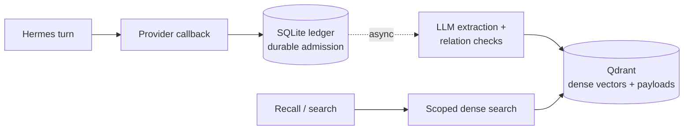

# Hermes Qdrant 记忆插件

**One Memory. Multiple Agents.**

面向 AI Agent 的持久化、可移植、权限感知记忆。

当前 checkout 中新增的共享部署加固措施记录在
[受保护目的地指南](docs/shared-memory/deployment-security.md)和
[版本化威胁模型](docs/shared-memory/threat-model-v1.md)中。这些新增内容包含在 Runtime 0.5.1 中。
远程访问需要安装 `[remote]` extra。

## One Memory, Multiple Agents — 可选的共享 owner

Runtime 0.5.0 新增可显式启用的本地认证共享 owner 与 stdio 桥接。多个 Agent 可以共享
一个明确授权的空间，旧记录继续保持私有。Hermes Native Provider 与现有私有默认行为
保持不变。配置、Hermes/DSH 操作示例与限制见[共享记忆指南](docs/shared-memory/README.zh-CN.md)，
架构见[架构说明](docs/shared-memory/architecture.md)，验证见[验证报告](docs/shared-memory/report.md)。
Runtime 0.5.0 新增可选启用的 Native Owner 提取、设备授权和 HTTPS MCP。
见[远程 Owner 指南](docs/shared-memory/remote-owner.md)。

[](https://github.com/cnkang/hermes-plugin-qdrant-memory/actions/workflows/ci.yml)
[](https://github.com/cnkang/hermes-plugin-qdrant-memory/actions/workflows/platform-compat.yml)
[](https://github.com/cnkang/hermes-plugin-qdrant-memory/actions/workflows/standalone.yml)
[](https://github.com/cnkang/hermes-plugin-qdrant-memory/actions/workflows/codeql.yml)
[](https://www.python.org/downloads/)
[](LICENSE)

> **Runtime 0.5.1** 保留可显式启用的本地认证共享 owner，以及用于明确共享记忆的 stdio
> 桥接；同时保留 0.3.0 的可选离线 CPU embedding、受信初始化与 MCP Python SDK 1.x/2.x 支持。
> 显式写入继续按规范化文本去重，不调用 LLM。
> 本补丁修复受保护 Owner 的恢复路径，不改变 schema 与 collection 标识。
> 本指南选择 Runtime 0.5.1。安装前请在
> [PyPI](https://pypi.org/project/hermes-plugin-qdrant-memory/0.5.1/) 核实该版本是否已公开。
> 通用 MCP 发行包和托管启动器各自选择精确的 Runtime 依赖，分别发布。
> Hermes Plugin Catalog 使用独立审核的固定版本（不可变），PyPI 发布不会自动升级目录中的版本。
> 每个目的地仍只允许一个写入者。
> 参见[发布说明](docs/releases/0.5.1.zh-CN.md)和[验证记录](docs/validation.md)。

[English](README.md) | [简体中文](README.zh-CN.md)

0.5.0 新增[多 Agent 共享记忆](docs/shared-memory/README.zh-CN.md)：
可选启用本地认证 owner，不改变私有默认行为。

为 Hermes Agent 提供长期记忆的原生插件，以 `MemoryProvider` 实现。
Hermes 通过可信的 `ctx.llm` facade 执行提取。Qdrant 保存 named dense vector 和
schema-v1 payload。不使用 Mem0 SDK 或独立 LLM SDK，不发送遥测，不修改核心。

已收录于官方 [Hermes Plugin Catalog](https://hermes-agent.nousresearch.com/docs/plugins/qdrant-memory)，
属于社区维护插件。

## 工作原理

非 Hermes 用户可在私有的 Python 3.11+ 环境中安装：
`pip install 'hermes-plugin-qdrant-memory[mcp]==0.5.1'`（仅 CLI 可省略 `[mcp]`）。
`qdrant-memory` 是 CLI，`mcp` 是其服务子命令。Standalone 不需要 Hermes。
见[安装与快速开始](docs/standalone.md)。以 MCP 为主的 Agent 也可改用
[metadata-only 分发包](https://github.com/cnkang/qdrant-memory-mcp)。
公开发行见 [Runtime PyPI](https://pypi.org/project/hermes-plugin-qdrant-memory/)
和 [MCP 分发 PyPI](https://pypi.org/project/qdrant-memory-mcp/)。
Hermes 原生插件使用下文官方安装机制。授权升级前，请确认相同的 profile、collection
和 embedding pipeline。



## 为什么选择这个插件

- 为 Hermes Agent 提供持久、私有的记忆：对话成为自有 Qdrant 存储中的可检索记忆，
  支持召回、更新与按作用域删除。
- 它是 Hermes 原生 `MemoryProvider`，不是 Mem0。`migrate mem0` 可导入既有 Mem0
  导出数据。
- embedded Qdrant 无需独立服务。同一套代码可指向自建 Server 与 Qdrant Cloud。
- 完全本地部署可行：embedded Qdrant 加本地 Ollama，数据留在本机。
- 数据位置取决于目的地。提取使用 Hermes 配置的 LLM，向量化使用配置的 embedding
  服务，两者都可能为远程服务。见[数据流与隐私](#数据流与隐私)。
- 本预览版不支持：多写入者 Server/Cloud、hybrid 检索和 Web UI。

## 额外兼容其他 agent

插件主要提供 Hermes Agent 的持久记忆集成。作为附加能力，其共享后端可通过 Runtime 的
`qdrant-memory --home PATH` JSON CLI 和可选的本地 stdio MCP 接口为其他 Agent 服务。
独立使用不需要 Hermes。这些接口支持显式、限定作用域的记忆操作以及维护/迁移。
自动提取与预取通过 Hermes Native Owner 或显式启用的 Pi 生命周期适配器提供。配置与边界见[独立运行指南](docs/standalone.md)，
多 Agent 安装与使用说明见通用的
[qdrant-memory skill](https://github.com/cnkang/skills/tree/main/qdrant-memory)。

可选 MCP 服务暴露四个限定作用域的工具：`qdrant_memory_search`、
`qdrant_memory_add`、`qdrant_memory_update` 和 `qdrant_memory_delete`。
兼容客户端以本地 stdio 进程启动它，并发现和调用这些工具。维护与迁移使用运维 CLI。
配置、共享记忆边界与已验证的 Agent 矩阵见
[MCP 能力与接入指南](docs/mcp.md)。Runtime 0.2.0 发布了这些接口。
已发布的 v0.1.0 插件版本不包含 MCP 入口。

## 演示


录屏展示在干净 profile 上的完整流程：安装已验证的固定版本源码、教一条偏好，
等待后台提取，然后在新会话中召回该偏好，并清理演示作用域。所有步骤都在
embedded 模式下运行。`scripts/demo.sh` 以固定版本复现同一流程。

## 选择安装入口

| 使用场景 | 推荐入口 | 说明 |
|---|---|---|
| Hermes 原生自动记忆 | Native MemoryProvider | 在 Hermes 内自动提取与召回 |
| 单 Agent 独立 MCP | Standalone MCP (`qdrant-memory-mcp`) | 仅显式工具，无自动提取 |
| 多 Agent 共享记忆 | 认证 Shared Owner | 可选。每个目的地一个 writer |
| 远程 / 多设备接入 | HTTPS MCP + Owner | 需 TLS、认证与网络保护 |
| WorkBuddy / DSH | 宿主集成指南 | 复用同一 Runtime |
| 迁移 Mem0 数据 | 迁移 CLI | 源 ID、可恢复 manifest、验证 |

详见[独立部署](docs/standalone.md)、[共享记忆](docs/shared-memory/README.zh-CN.md)、[跨 Harness 架构](https://github.com/cnkang/qdrant-memory-mcp/blob/main/docs/cross-harness-architecture.md)。

## 安装

要求：Python 3.11+、兼容的 Hermes 安装以及可访问的 embedding 服务。最低支持的
Hermes 版本为 v0.21.5（v2026.9.24）。[CI 服务](docs/ci.md)页面记录了已测试的
主机版本。默认模型需要 Ollama，并需要足够的本机资源来提供 `qwen3-embedding:4b`。

明确选择**当前活动 profile** 的 home。不要复用其他 profile 的数据。

**Catalog 方案：安装官方 Hermes Plugin Catalog 审核过的版本。**

Catalog 独立选择固定提交，该版本可能早于 Runtime 0.5.1。如需使用当前发布版本
（包括可选启用的共享记忆），请采用下方推荐的固定版本安装方式。

```bash
export HERMES_HOME="/absolute/path/to/your/hermes-profile"
ollama pull qwen3-embedding:4b
# 如果 Ollama 尚未运行，先启动服务并保持其可用。
hermes plugins install qdrant-memory
hermes plugins enable qdrant-memory
hermes memory setup
hermes config set memory.provider qdrant-memory
hermes qdrant-memory init
```

安装会解析 Catalog 审核过的提交，并在克隆前打印该条目声明的工具、要求与已知问题。
`hermes plugins enable` 通过 Hermes PM 准备声明的依赖。

**推荐：通过 Hermes CLI 安装固定版本的 Runtime 0.5.1 源码。**

此不可变源码提交包含可选启用的共享记忆。它不依赖 PyPI 发布或 Catalog 更新。

```bash
export HERMES_HOME="/absolute/path/to/your/hermes-profile"
ollama pull qwen3-embedding:4b
# 如果 Ollama 尚未运行，先启动服务并保持其可用。
hermes plugins install https://github.com/cnkang/hermes-plugin-qdrant-memory \
  --ref 40ac832ab2093e1614c88ef219d1f6a0ef4701a9   # Runtime 0.5.1 release
hermes plugins enable qdrant-memory
hermes memory setup
hermes config set memory.provider qdrant-memory
hermes qdrant-memory init
```

**上一验证源码：通过 Hermes CLI 安装 Runtime 0.3.0。**

此较早的不可变源码提交包含可选 CPU embedding 与引导初始化，但早于可选启用的共享
记忆。当前版本请使用上方 Runtime 0.5.1。它不依赖 PyPI 发布或 Catalog 更新。

```bash
export HERMES_HOME="/absolute/path/to/your/hermes-profile"
ollama pull qwen3-embedding:4b
# 如果 Ollama 尚未运行，先启动服务并保持其可用。
hermes plugins install https://github.com/cnkang/hermes-plugin-qdrant-memory \
  --ref 534562f1df43541dbf906d248bb11cd085b211ee   # verified Runtime 0.3.0 source
hermes plugins enable qdrant-memory
hermes memory setup
hermes config set memory.provider qdrant-memory
hermes qdrant-memory init
```

对于这种固定版本形式，`hermes plugins install` 会检出指定 ref，`hermes plugins enable`
通过 Hermes PM 准备声明的依赖。`--ref` 接受完整 40 字符 commit SHA。
[releases 页面](https://github.com/cnkang/hermes-plugin-qdrant-memory/releases)
列出各发布提交。不要向受管理的 Hermes 环境执行 pip install。省略 `--ref` 即跟踪
`main`，也就是开发线。

**历史发行版本：手动克隆已发布的 tag。**

下方 v0.1.0 tag 早于独立接口和显式写入修复。Runtime 0.5.1 请使用上方固定源码。

```bash
export HERMES_HOME="/absolute/path/to/your/hermes-profile"
mkdir -p "$HERMES_HOME/plugins"
RELEASE_TAG=v0.1.0   # 设为已发布的 release tag
git clone --branch "$RELEASE_TAG" --depth 1 \
  https://github.com/cnkang/hermes-plugin-qdrant-memory.git \
  "$HERMES_HOME/plugins/qdrant-memory"
ollama pull qwen3-embedding:4b
# 如果 Ollama 尚未运行，先启动服务并保持其可用。
hermes memory setup
hermes config set memory.provider qdrant-memory
hermes qdrant-memory init
```

然后验证安装：

```bash
hermes qdrant-memory status
hermes qdrant-memory doctor
```

安装健康时会报告目的地、embedding 服务和 schema fingerprint。`doctor` 校验运行时
发现、manifest 解析、导入与注册。开发安装见[开发指南](docs/development.md)。

发布说明、支持的 Hermes/Python 版本和当前限制见
[docs/releases/v0.1.0.md](docs/releases/v0.1.0.md)。`main` 始终是开发线。

本地开发时，可将仓库软链接到一个可丢弃的 profile：

```bash
mkdir -p "$HERMES_HOME/plugins"
ln -s /path/to/hermes-plugin-qdrant-memory "$HERMES_HOME/plugins/qdrant-memory"
hermes memory setup
hermes config set memory.provider qdrant-memory
```

修改配置后请重启会话。现有系统提示与工具集保持不变，以维持 prompt 缓存。包安装方式
提供 `hermes_agent.memory_providers` entry point，并将 `cli.py` 与 `config_schema.py`
保留在包入口旁。

默认使用 embedded Qdrant 和 Ollama `qwen3-embedding:4b`（2560 维）。启用 provider 前
先运行 embedding 服务并提供该模型。Server/Cloud 请在 `$HERMES_HOME/qdrant-memory.json`
中配置模式。在当前 profile 的 secret scope 中提供 `QDRANT_URL` / `QDRANT_API_KEY`。

## 已实现能力

- embedded、自托管 Server 与 Cloud 使用同一个 Qdrant client。
- Ollama `/api/embed` 与 OpenAI-compatible `/v1/embeddings`，带严格探测、
  向量数量/维度校验和 pipeline fingerprint 检查。
- 继承主 LLM、插件辅助任务路由，以及运维方信任的显式覆盖。
- user/agent 作用域过滤，用于召回、按精确 ID 更新与删除。
- Hermes 接纳 provider 回调后，轮次持久化到插件的私有 SQLite 账本。串行写入、
  会话缓存召回和 builtin memory 镜像都使用权威的 `previous_content`。
- SQLite WAL 事件/操作账本、传输重试和重启恢复。
- 仅按 source ID 的 Mem0 JSON/Qdrant 迁移、重新 embedding、dry-run、可恢复
  manifest、增量更新，以及 ID 与 payload hash 校验。
- 只读 `list` 盘点、可移植 `export`（Mem0 可导入 JSON），以及带已准备写入围栏的
  持久化作用域 `delete-all`。

与托管记忆服务不同，记忆数据保存在你自己的 Qdrant 目的地。插件不调用任何外部记忆
服务。其私有 SQLite 账本（待处理操作、去重/重试记录和会话映射）留在本地 Hermes home。
请将该 home 与 Qdrant 数据一并备份。从 Mem0 的迁移是单向的，0.1 版不支持向量复用
或 hybrid 检索。

显式 add 只在同一作用域内按规范化文本去重，从不调用 LLM。不同文本无论相似度高低都
会保存。update 只替换已授权的精确 ID。Hermes 自动提取时，相似度是候选筛选信号，
不能证明两条事实完全相同。`SAME` 跳过，`SUPERSEDES` 更新，`CONFLICT` 创建关联记录，
`UNRELATED` 新增记录。迁移使用 source ID，不做语义合并。

四个 Agent 工具为 `qdrant_memory_search`、`qdrant_memory_add`、
`qdrant_memory_update` 和 `qdrant_memory_delete`。维护操作保留在 CLI：

```bash
hermes qdrant-memory status
hermes qdrant-memory init
hermes qdrant-memory doctor
hermes qdrant-memory stats
hermes qdrant-memory verify
hermes qdrant-memory retry
```

`status` 仅在本地运行。`doctor` 与 `verify` 探测已有 collection，但不创建或修复它。
首次配置后运行 `init`，以探测 embedding、创建 collection、记录其 pipeline fingerprint
并建立 Server/Cloud payload 索引。它不调用 LLM，也不写入对话记忆。重复运行会校验
现有 collection。维度、距离或 fingerprint 不兼容时会失败，且不覆盖已有数据。
collection 已存在时，`init` 询问选择 `use`（回车默认）还是 `clear`。`use` 校验 named
dense vector、维度、距离和 pipeline 身份，然后检查每条已存记忆的 payload、内容 hash
和向量。校验失败返回非零退出码。没有可信 fingerprint 的非空 collection 无法被插件复用。
`clear` 先探测 embedding，再删除并重建目标 collection，同时丢弃该目的地的本地重放工作
和迁移记录。插件保留其他目的地，以及会话来源隔离区。清空不可撤销，删除/重建也不是原子
操作。远端重建失败时请重新运行 `init`。
清空中断会留下持久的重置意图。其他目的地命令会以 `reset_recovery_required` 失败。
在同一目的地重新运行 `init`，即可在启用 provider 前继续已授权的重置。
脚本中请显式传入 `--existing use` 或 `--existing clear`。`clear` 即授权删除。
`--collection NAME` 只覆盖本次命令的目标，不改变后续 Agent 会话使用的 collection。
`init`、`migrate` 和 `retry` 在所有部署模式下都要求独占写入权。OS lease 只协调使用
该 profile 目的地的本机进程，不是分布式锁。运行前请停止所有主机上向同一目的地写入的
Hermes 会话或 gateway。若 `doctor` 已报告 `ok: true`，collection 已就绪，无需初始化。
远端 `doctor`、`stats` 和 `verify` 可在 writer 运行时检查它。`retry` 会把失败事件
重新排入下次 provider 启动，并重试已准备的操作。对 embedded 存储执行维护前请停止
Agent。Qdrant 的本地持久化只允许一个 client 进程。

## 记忆盘点、导出与按作用域删除

```bash
hermes qdrant-memory list                        # 只读盘点
hermes qdrant-memory export --output backup.json # 可再导入的便携 JSON
hermes qdrant-memory delete-all --user alice --confirm
```

`list` 报告已存记忆的作用域、来源和时间戳，也报告该目的地的待处理/失败操作计数。
用 `--user` 和 `--agent` 过滤；两者都省略则覆盖整个 collection。`--limit` 限制输出，
且命令拒绝只给 `--agent` 而不给 `--user` 的调用。
`export` 将所有已存记忆（可限定一个作用域）写成 Mem0 导入器接受的便携 JSON。
`hermes qdrant-memory migrate mem0 --source-json backup.json` 可将其恢复到新的目的地
（导入会重新 embedding，0.1 版不支持向量复用）。往返保留文本、作用域、分类和时间戳。
从 Mem0 迁移的记忆会重新导入到相同的 point，原生记忆在导出记录中保留原始 point UUID
作为来源。插件写出的导出文件仅属主可读，已存在时须加 `--force` 才覆盖。导出只包含
已存记忆。待处理事件、重试历史和崩溃恢复状态留在本地账本。完整恢复点请备份 profile home。

`delete-all` 持久删除一个作用域（必须提供 `--user`）的已存记忆和待处理工作。它先记录
reset 风格的意图，然后为该作用域内每个枚举到的 point 和每个已准备的写入登记围栏，
包括 point 从未落库的写入。它使该作用域内已接纳但未处理的轮次事件失效，以一次过滤
操作删除该作用域，并且只在该作用域为空后清除意图。作用域是精确的 (user, agent) 对。
省略 `--agent` 选择无 agent 的作用域，而默认 profile 作用域使用 agent（`hermes`）。
用 `--agent hermes` 指向它，或用 `--all-agents` 删除该用户的全部 Agent 作用域。
未使用 `--all-agents` 时，若其他 Agent 作用域仍有记忆，结果会报告 `other_agent_scopes`。
字面量 `*` 是普通 agent id，不是通配符。`--dry-run` 预览各作用域的计数。
`--confirm` 授权删除。删除中断时 fail-closed：其他命令和 provider 启动都会返回
`scope_delete_recovery_required`，直到 `delete-all --confirm` 恢复该操作。删除意图
带版本且显式。未带版本的意图无法区分 `*` 是单个 Agent 还是全部 Agent，因此插件会拒绝
它（`scope_delete_legacy_intent`）。用 `--resolve-legacy single_agent` 解决，或在记录
的 agent 为 `*` 或缺失时使用 `--resolve-legacy all_agents`。删除后接纳的轮次仍可新增
记忆。删除前接纳的所有内容（已存记忆、已准备的写入和未处理的轮次事件）都会被移除或
失效。`list`、`export` 和 `delete-all` 不需要 embedding 服务。

## 数据流与隐私

本 provider 只向你所配置的服务发送数据。各组件携带的内容与去向：

| 组件 | 携带内容 | 去向 |
| --- | --- | --- |
| 对话/Agent 轮次 | 你的对话内容 | Hermes 会话配置的模型 |
| 记忆提取（`llm.mode: inherit`） | 本轮用户与助手文本 | 同一会话模型。使用云端模型时，轮次文本会到达该云端 |
| 关系判断 | 候选记忆与相似的已存记忆 | 与提取相同的路由。仅在相似度选中复核候选时运行 |
| 向量化（`embedding`） | 记忆与搜索文本 | 默认 Ollama，或你配置的 OpenAI 兼容端点 |
| 存储（`qdrant`） | 记忆 payload 与来源信息。账本留在本地 | 本地 embedded 路径、自托管 Server 或 Qdrant Cloud |

三种常见部署：

| 部署 | 对话模型 | 提取 LLM | 向量化 | 存储 |
| --- | --- | --- | --- | --- |
| 全离线 | 本地（例如 Ollama） | 继承本地模型 | 本地 Ollama | 本地 embedded |
| 混合 | 云端 | 默认继承云端模型 | 本地 Ollama | 本地 embedded |
| 全云端 | 云端 | 云端 | OpenAI 兼容端点 | Qdrant Cloud |

全离线部署需要同时为对话模型和向量化准备足够的本机算力。在 24 GB 主机上，27B 本地
对话模型加本地向量化在验证期间已超出舒适显存。本地模型每轮可能耗时数分钟。请据此
规划资源，或改用更小的本地模型。

在混合部署中，提取和关系判断继承会话模型。可用 `llm.mode: task`（插件辅助任务路由到
本地模型）或 `llm.mode: override`（显式 provider 与模型）将它们路由到别处。
提取指令会排除明显的凭据和瞬时状态，但任何已配置的 LLM 或 Qdrant 目的地都可能看到
它处理的记忆。请据此评估信任边界。本地账本的逻辑清理不等于安全擦除。见
[运维文档](docs/operations.md)和[安全文档](docs/security.md)。

提取和关系判断作为 Hermes 辅助调用运行。其按任务超时默认 30 秒，慢速本地模型很容易
超过。全本地部署请调大 `auxiliary.qdrant_memory_extraction.timeout`（秒）。超时的
提取会成为失败工作，可用 `hermes qdrant-memory retry` 重新排队。

## 配置与迁移

行为配置位于 `$HERMES_HOME/qdrant-memory.json`。凭据属于当前 profile 的 Hermes
secret scope。默认使用 embedded Qdrant。运行 setup 时，向导会复用当前 profile 环境中已有的
`QDRANT_URL` 和 `QDRANT_API_KEY`，不再额外提示。setup 会报告这些变量是否存在，但不
显示其值，只询问缺失项，并保存环境引用而不是复制提供的值或密钥。环境 URL 会替换已保存
插件设置中的旧显式 URL。Server 或 Cloud 请设置 `qdrant.mode`、collection 和端点。
Cloud 要求 HTTPS 和 Database API key。[配置示例与默认值](docs/configuration.md)
涵盖 Ollama、OpenAI 兼容 embedding、LLM 路由和显式 fallback。

使用独立的目标 collection，并保持 Mem0 来源不变：

```bash
hermes qdrant-memory migrate mem0 --source-json /path/to/export.json --dry-run
# 停止 CLI/前台 writer；对于已安装的后台 gateway：
hermes gateway status
hermes gateway stop
hermes qdrant-memory migrate mem0 --source-json /path/to/export.json \
  --target-collection hermes_qdrant_memory --resume --verify
hermes qdrant-memory verify --collection hermes_qdrant_memory
```

重新 embedding 是默认行为。`--resume` 需要相同的 snapshot 和 pipeline。加
`--retry-failed` 可按该 manifest 重试失败操作。迁移验证检查精确 ID、作用域和 payload
hash，而不只是记录数。被取消的迁移记录成为终态 `SUPERSEDED` 工作，绝不计为成功写入。
resume 保留后续的删除意图。`--verify` 会以非零退出码报告 `migration_superseded` 冲突。
只要仍有失败记录，`--verify` 会报告 `migration_incomplete`。请先修正并 resume 失败项，
再审查冲突或进行有意的新导入。只有新导入或更改的 snapshot 才授权重新规划。
恢复按有限分页读取操作和事件。保留的账本历史仍需监控磁盘容量。
真实导入前，停止所有向目标写入的会话/gateway，Server/Cloud 也一样。`writer_busy`
要求停止活动 writer，而不是删除锁文件或账本文件。成功的 dry-run 不检查写入者所有权。
可执行的 gateway 停止/启动、迁移、验证和中断导入恢复命令见
[迁移指南](docs/migration-from-mem0.md)。

## 运维与安全

私有 SQLite 账本可能包含原始轮次事件和已准备的 payload。它会逻辑清除已提交事件的正文
以及已提交/已 supersede 操作的正文，但仍被未完成迁移 manifest 需要的操作除外。
身份/状态行和 manifest 保留。待处理/失败工作会保留正文以支持恢复。账本行和 manifest
没有基于时间的过期策略。删除 Qdrant 记忆不会清除待处理或失败的账本工作。请将
`state.db`、SQLite WAL/SHM sidecar、复制的快照和备份视为敏感数据。用 embedded 存储
备份账本前请停止 Agent。`init --existing clear` 会清除所选 collection 的账本行，但
逻辑清除/重置不等于从磁盘页面或此前复制的备份中安全擦除。不要通过删除 `state.db`
来恢复失败工作。更改 embedding 身份需要新的 collection。

持久化保证从 Hermes 调用 provider 的 `sync_turn` 回调、且插件将事件提交到 SQLite 后
才开始。Hermes 目前将该回调提交到内存后台队列。宿主突然退出或其有界 shutdown 可能
丢弃尚未进入插件接纳流程的工作。账本接纳后，插件会在重启后重放待处理事件和已准备
操作。该插件账本无法让更早的宿主队列变为持久队列。

工具参数不能覆盖 user/agent 作用域。自动写入排除 bot 和非 primary Agent 的轮次。
请将召回内容视为不可信数据。见[安全](docs/security.md)、[运维流程](docs/operations.md)、
[故障排查](docs/troubleshooting.md)和[架构](docs/architecture.md)。

## 能力与限制

| 领域 | 状态 | 说明 |
|---|---|---|
| 私有记忆（独立） | 支持 | Embedded / Server / Cloud Qdrant |
| 自动提取（Hermes） | 支持 | 受信任的 `ctx.llm` facade |
| 自动召回（Hermes） | 支持 | 作用域 dense search |
| 共享记忆（Shared Owner） | 可选 | 每个目的地一个 writer。默认关闭。WriterLease 仅协调当前 profile，不能阻止不同 profile 或设备的并发写入 |
| 自动共享提取 | 可选 | Native Owner 和可选启用的 Pi 生命周期适配器 |
| MCP 自动提取 | 不支持 | 仅显式工具 |
| Hybrid 检索 / 重排序 | 不支持 | 仅 dense 检索（v0.1） |
| 多 writer Server/Cloud | 不支持 | 单一权威 writer |
| Web UI | 不支持 | 仅 CLI 与工具 |

## 兼容性与范围

0.1 版实现 dense 检索。Hybrid sparse vector、RRF/DBSF、rerank 和 recency weighting
属于后续能力。插件会拒绝不支持的配置。named `dense` vector 保留了通向未来 sparse
vector 的路径。

插件对 embedding `inherit` 做特性探测，并要求显式 `inherit_fallback`。未来的宿主
facade 必须提供 `dimensions`、`fingerprint`、`embed_documents()` 和 `embed_query()`。
当前 Hermes 没有文档化的全局 embedding facade。

兼容性要求 Hermes `MemoryProvider`、checkpoint v2、可信的轮次作者、权威的 builtin
`previous_content`、限定作用域的 secret 和 context thread。更早的 tag 契约不完整。
最低支持版本为 v0.21.5（v2026.9.24）。已测试环境和仍需实机验证的服务检查见
[验证记录](docs/validation.md)。部署前请阅读[配置](docs/configuration.md)、
[迁移](docs/migration-from-mem0.md)、[安全](docs/security.md)和
[运维](docs/operations.md)。

## 开发

提交前运行 Ruff lint 和格式检查。按[开发指南](docs/development.md)安装仓库 pre-commit
hook。该 hook 检查暂存快照。CI 运行 lint、两个 Python 版本、Snyk 和 SonarCloud。
已测试的主机版本与 lane 见 [CI 服务](docs/ci.md)。

用 Hermes PM 构建隔离的依赖环境，再用宿主的 canonical 测试运行器运行本仓库的测试。
测试会导入真实宿主，并使用临时的 `HERMES_HOME`。

```bash
cd /path/to/hermes-agent
python -m pm.build_env --source /path/to/hermes-agent --group test \
  --export-requirements /tmp/hermes-qdrant-test-requirements.txt
python -c 'import sys, tomllib; from pathlib import Path; p = tomllib.loads(Path(sys.argv[1]).read_text()); print("\n".join(p["project"]["dependencies"] + p["dependency-groups"]["test"]))' \
  /path/to/hermes-plugin-qdrant-memory/pyproject.toml >> /tmp/hermes-qdrant-test-requirements.txt
python -m pm.build_env --out /path/to/hermes-plugin-qdrant-memory/.test-env \
  --requirements /tmp/hermes-qdrant-test-requirements.txt
HERMES_PYTHON=/path/to/hermes-plugin-qdrant-memory/.test-env/bin/python \
  scripts/run_tests.sh /path/to/hermes-plugin-qdrant-memory/tests -j 1 --file-retries 0
```

构建会从 `pyproject.toml` 读取插件的 `test` 开发依赖组。已测试的宿主 PM 只导出运行
时依赖。构建组合环境前，先追加插件的运行时依赖和测试组。

在插件 checkout 中，用宿主导入路径运行真实 embedding pilot：

```bash
PYTHONPATH=/path/to/hermes-agent .test-env/bin/python scripts/evaluate.py
```

它使用临时 embedded collection 和 UTF-8 JSON 数据集。自定义数据集包含带 `id`/`text`
的 `memories` 对象，以及带 `query`/`relevant_ids` 的 `queries`。默认 fixture 现包含
24 条带标签查询，涵盖中文、英文、混合语言和 hard-negative 场景。
[最初的 12 条查询记录](docs/retrieval-baseline.json)是历史合成回归基线。当前测量请
重跑当前 fixture。这些 fixture 不能证明生产召回质量。独立的合成重放与保留存储测量见
[恢复基准](docs/recovery-benchmark.md)。

CI 运行测试、SonarCloud 质量门禁以及 Snyk 依赖/代码扫描。
见 [CI 服务配置](docs/ci.md)和[验证证据](docs/validation.md)。

## 文档导航

- [独立部署 / 快速开始](docs/standalone.md)
- [架构](docs/architecture.md)
- [配置](docs/configuration.md)
- [跨 Harness 共享（MCP 仓库）](https://github.com/cnkang/qdrant-memory-mcp/blob/main/docs/cross-harness-architecture.md)
- [共享记忆](docs/shared-memory/README.zh-CN.md)
- [安全](docs/security.md)
- [运维](docs/operations.md)
- [从 Mem0 迁移](docs/migration-from-mem0.md)
- [备份与可移植性](docs/portability.md)
- [验证与证据](docs/validation.md)
- [开发](docs/development.md)
- [CI](docs/ci.md)

## 验证与证据

真实证据，而非徽章：

- Hermes 原生生命周期测试：[验证](docs/validation.md)
- 跨 Harness 共享：[OpenCode / Pi 双设备验收](docs/validation/cross-device-opencode-pi-2026-10.md)；WorkBuddy / DSH：尚未完成完整宿主验证（[报告](docs/shared-memory/report.md)）
- 崩溃 / 重启 / 幂等性：[有界恢复](docs/recovery-benchmark.md)
- 授权与隔离：[安全](docs/security.md)、[威胁模型](docs/shared-memory/threat-model-v1.md)
- 模型质量：冻结评估数据集（见 `scripts/evaluate.py`）

长期 24 小时验收：待完成 / 尚未验证。

## 许可证

MIT。Copyright © 2026 Kang Liu。见 [LICENSE](LICENSE)。
